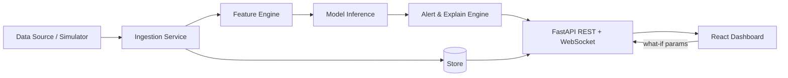

# Architecture.md

## Default stack (change only if PS demands)
- Frontend: React + Vite + TypeScript + Tailwind + Recharts
- Backend: FastAPI (Python 3.11), Pydantic, WebSocket/SSE
- ML: pandas, scikit-learn, statsmodels, LightGBM, river, SHAP
- DB: SQLite (dev) → Supabase Postgres (deploy); DuckDB optional
- Deploy: Vercel (web) + Render/Railway (api)
- LLM (optional): Gemini/Groq for natural-language insights

## High-level flow


## Folder structure
```
project/
├── brain/                # all docs (this folder)
├── CLAUDE.md  AGENTS.md  .cursorrules
├── api/
│   ├── main.py           # app entry, routers, CORS
│   ├── core/             # config.py, logging.py, deps.py
│   ├── routers/          # health.py, predict.py, stream.py, alerts.py
│   ├── services/         # ingest.py, features.py, model.py, explain.py, alerts.py
│   ├── models/           # schemas.py (pydantic), db.py (ORM)
│   ├── ml/               # train.py, evaluate.py, artifacts/ (joblib)
│   └── tests/
├── data/                 # raw/, processed/, sample/ (small CSVs)
├── web/
│   └── src/
│       ├── components/   # charts/, cards/, layout/
│       ├── pages/        # Dashboard, Insights, Settings
│       ├── hooks/        # useStream.ts, usePredictions.ts
│       ├── lib/          # api.ts, format.ts
│       ├── store/        # zustand
│       └── styles/
├── docs/                 # architecture diagram, screenshots, pitch deck
├── scripts/              # seed_data.py, replay_stream.py
├── .env.example
├── docker-compose.yml    # optional
└── README.md
```

## API contract (draft)
| Method | Path | Purpose |
|---|---|---|
| GET | /health | liveness |
| GET | /api/history?window= | past data |
| GET | /api/predict?horizon= | forecast |
| POST | /api/whatif | scenario prediction |
| GET | /api/alerts | anomaly list |
| WS | /ws/stream | live points + predictions |

## Data flow rules
- Every stream message: `{ts, value(s), prediction, anomaly:boolean, confidence}`
- Replay mode: `scripts/replay_stream.py` pushes a CSV at N× speed (works w/o internet)
- Model artifacts loaded once at startup; retrain endpoint optional

## Key decisions log
Add decisions here (and in Memory.md): what/why/date.
